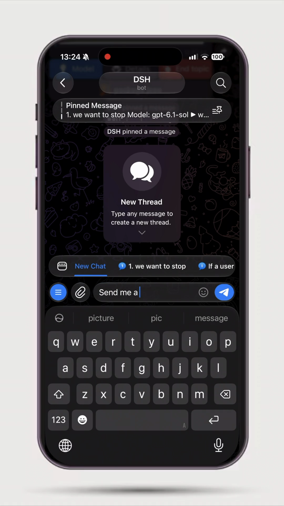

# Telegram Remote

[English](README.md) · [简体中文](README.zh-CN.md) · [Русский](README.ru.md)

Control DeepSeek Harness from a private Telegram bot, built around **Telegram threads and modern native messaging features**.

## Features

- **Session topics:** open existing DSH sessions on demand or create one through Telegram’s native **New Topic** action.
- **Native streaming:** draft replies, Telegram’s Stop button, live tool previews, and best-effort typing indicators. Completed messages and stopped partial answers stay in the chat. Markdown replies use Telegram Rich Messages for native headings, lists, tables, quotes, code and formulas.
- **Model controls:** choose providers, models, and supported reasoning-effort levels in place, including the model’s default effort.
- **Workspace selection:** choose an existing DSH workspace when creating a session.
- **Pinned checklists:** the first todo list is pinned; later updates edit the same message across conversation turns.
- **Readable activity logs:** collapsed tool logs with truncated model-reasoning previews and configurable custom emoji icons.
- **User questions:** answer blocking questions with single/multiple choices, explicit text replies, or Skip. Timed/late questions and specialized approval/plan reviews remain on existing Harness surfaces.
- **Interactive approvals:** review the requested operation and approve or reject it with colored buttons.
- **Session controls:** pinned session details, queue steering, and topic management. Ending a Telegram topic does not delete or stop its DSH session.
- **Incoming media:** send images, stickers, audio/voice, videos or documents (up to 10 MiB each). Files are saved as UUID-named files in the session workspace’s `.dsh-telegram-remote/` directory; their `@path` and caption are forwarded to DSH. Reading/transcription depends on the model and available tools. Albums are handled as separate messages.
- **File delivery:** receive supported photos, video, and audio natively, or download documents and files touched during a turn.
- **Localized and efficient:** English, Chinese, and Russian UI; coalesced progress updates, independent topic scheduling, and rate-limit backoff.

## Preview

[Watch the demo](https://raw.githubusercontent.com/paranoidPhantom/dsh-telegram-remote/main/preview.mp4).

## Install

1. Open DSH **Plugin Manager** and install **`dsh-telegram-remote`** from npm.
2. Restart DSH if requested, then open **Settings → Telegram Remote**.
3. Save your BotFather bot token and numeric Telegram admin user ID. Tokens are stored in DSH credentials.
4. Enable private-chat topics in **@BotFather → /mybots → your bot → Bot Settings → Topics**. [Tutorial](https://www.reddit.com/r/hermesagent/comments/1ta5o5g/tutorial_threaded_messages_on_telegram_dm/).
5. Open your bot and send `/start`. Use `/sessions` or Telegram’s **New Topic** to begin.

DSH must remain running: Telegram networking runs in a child process supervised by the DSH plugin, not an independent daemon. Only the configured admin can control the bot.

## Contributing

Pull requests and feature requests are welcome! [Open a pull request](https://github.com/paranoidPhantom/dsh-telegram-remote/pulls) or [suggest a feature](https://github.com/paranoidPhantom/dsh-telegram-remote/issues).
