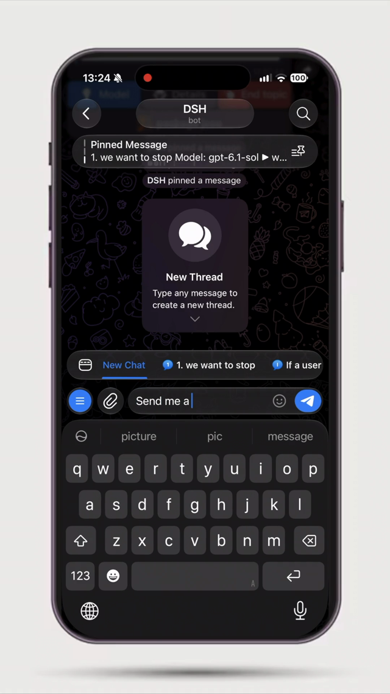

# Удалённый доступ через Telegram

[English](README.md) · [简体中文](README.zh-CN.md) · [Русский](README.ru.md)

Управляйте DeepSeek Harness через личного Telegram-бота с **темами Telegram и современными нативными функциями сообщений**.

## Возможности

- **Сессии по темам:** открывайте существующие сессии DSH по запросу или создавайте новые через нативное действие Telegram **New Topic (Новая тема)**.
- **Нативный стриминг:** черновики ответов, кнопка остановки Telegram, предпросмотр инструментов и индикаторы набора при поддержке клиента. Завершённые сообщения и частичные ответы после остановки остаются в чате. Markdown-ответы используют Telegram Rich Messages для нативных заголовков, списков, таблиц, цитат, кода и формул.
- **Выбор модели:** переключайте провайдера, модель и поддерживаемый уровень рассуждений без переходов, включая уровень по умолчанию.
- **Выбор рабочей области:** при создании сессии можно выбрать существующую рабочую область DSH.
- **Закреплённые списки задач:** первый список закрепляется, а последующие обновления редактируют то же сообщение между ходами разговора.
- **Читаемые журналы:** свёрнутые журналы инструментов с сокращёнными фрагментами рассуждений модели и настраиваемыми пользовательскими эмодзи.
- **Вопросы пользователю:** отвечайте на блокирующие вопросы одним или несколькими вариантами, прямым текстовым ответом или пропуском. Вопросы с таймером/поздними ответами и специальные согласования/проверки планов остаются в существующих интерфейсах Harness.
- **Интерактивные подтверждения:** просматривайте запрошенную операцию и разрешайте или отклоняйте её цветными кнопками.
- **Управление сессией:** закреплённые сведения, управление очередью и темами. Завершение темы Telegram не удаляет и не останавливает сессию DSH.
- **Входящие медиа:** отправляйте изображения, стикеры, аудио/голосовые сообщения, видео и документы (до 10 МиБ каждый). Файлы сохраняются с именами UUID в каталоге `.dsh-telegram-remote/` рабочей области сессии; `@путь` и подпись передаются DSH. Чтение/расшифровка зависит от модели и доступных инструментов. Альбомы обрабатываются как отдельные сообщения.
- **Отправка файлов:** получайте поддерживаемые фото, видео и аудио средствами Telegram, скачивайте документы и файлы, затронутые в ходе работы.
- **Локализация и эффективность:** интерфейс на английском, китайском и русском; объединение обновлений, независимое планирование по темам и задержки при ограничении частоты запросов.

## Демонстрация

[Смотреть демонстрацию](https://raw.githubusercontent.com/paranoidPhantom/dsh-telegram-remote/main/preview.mp4).

## Установка

1. Откройте **менеджер плагинов DSH (Plugin Manager)** и установите **`dsh-telegram-remote`** из npm.
2. Перезапустите DSH, если потребуется, затем откройте **Настройки → Удалённый доступ через Telegram**.
3. Сохраните токен бота от BotFather и числовой ID администратора Telegram. Токены хранятся в учётных данных DSH.
4. Включите темы в личных чатах: **@BotFather → /mybots → ваш бот → Bot Settings → Topics**. [Инструкция](https://www.reddit.com/r/hermesagent/comments/1ta5o5g/tutorial_threaded_messages_on_telegram_dm/).
5. Откройте бота и отправьте `/start`. Начните работу через `/sessions` или **New Topic (Новая тема)** в Telegram.

DSH должен оставаться запущенным: сетевой обмен с Telegram выполняется в дочернем процессе под контролем плагина DSH, а не в независимом демоне. Управлять ботом может только указанный администратор.

## Участие в разработке

Приветствуются pull request’ы и предложения новых функций! [Предложите изменения](https://github.com/paranoidPhantom/dsh-telegram-remote/pulls) или [создайте запрос на новую функцию](https://github.com/paranoidPhantom/dsh-telegram-remote/issues).
