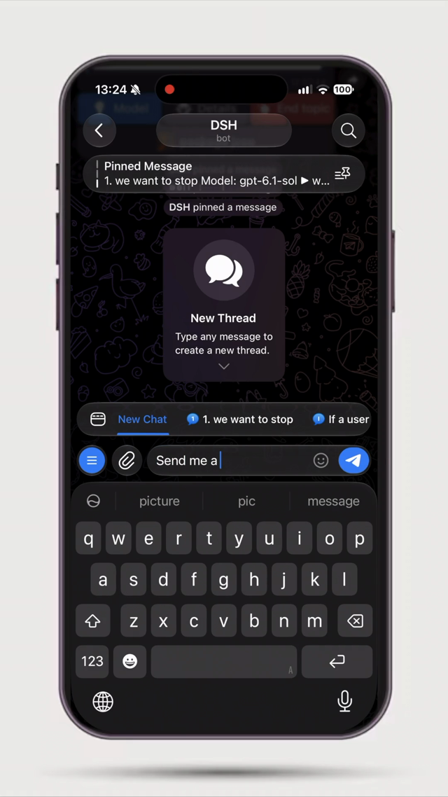

# Telegram 远程控制

[English](README.md) · [简体中文](README.zh-CN.md) · [Русский](README.ru.md)

通过私人 Telegram 机器人控制 DeepSeek Harness，以 **Telegram 话题和现代原生消息功能**为核心。

## 功能

- **会话话题：** 按需打开已有 DSH 会话，或通过 Telegram 原生的 **New Topic（新建话题）**操作创建会话。
- **原生流式输出：** 草稿回复、Telegram 停止按钮、实时工具预览，以及尽力提供的输入状态提示。完整消息和已停止的部分回答都会保留在聊天中。
- **模型控制：** 原地选择提供商、模型及其支持的推理强度，也可恢复模型默认强度。
- **工作区选择：** 创建会话时选择已有的 DSH 工作区。
- **置顶任务清单：** 首次创建的任务清单会置顶，后续更新跨轮次编辑同一条消息。
- **清晰的活动日志：** 折叠的工具日志、截断的模型推理预览，以及可配置的自定义表情图标。
- **交互式审批：** 查看请求执行的操作，并通过彩色按钮批准或拒绝。
- **会话控制：** 置顶会话详情、队列引导和话题管理。结束 Telegram 话题不会删除或停止 DSH 会话。
- **文件发送：** 原生接收支持的图片、视频和音频，或下载文档及本轮操作涉及的文件。
- **本地化与效率：** 英语、中文和俄语界面；合并进度更新、按话题独立调度，并在限流时退避。

## 预览

[观看演示](https://raw.githubusercontent.com/paranoidPhantom/dsh-telegram-remote/main/preview.mp4)。

## 安装

1. 打开 DSH **插件管理器（Plugin Manager）**，从 npm 安装 **`dsh-telegram-remote`**。
2. 如有提示，重启 DSH，然后打开 **设置 → Telegram 远程控制**。
3. 保存 BotFather 提供的机器人令牌和 Telegram 数字管理员用户 ID。令牌存储在 DSH 凭据中。
4. 在 **@BotFather → /mybots → 你的机器人 → Bot Settings → Topics** 中启用私聊话题。[教程](https://www.reddit.com/r/hermesagent/comments/1ta5o5g/tutorial_threaded_messages_on_telegram_dm/)。
5. 打开机器人并发送 `/start`。使用 `/sessions` 或 Telegram 的 **New Topic（新建话题）**开始。

DSH 必须保持运行：Telegram 网络通信由 DSH 插件监管的子进程处理，并非独立守护进程。只有配置的管理员可以控制机器人。

## 参与贡献

欢迎提交 PR 和功能请求！[提交 Pull Request](https://github.com/paranoidPhantom/dsh-telegram-remote/pulls)，或[提出功能建议](https://github.com/paranoidPhantom/dsh-telegram-remote/issues)。
